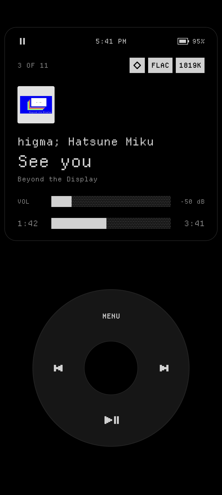
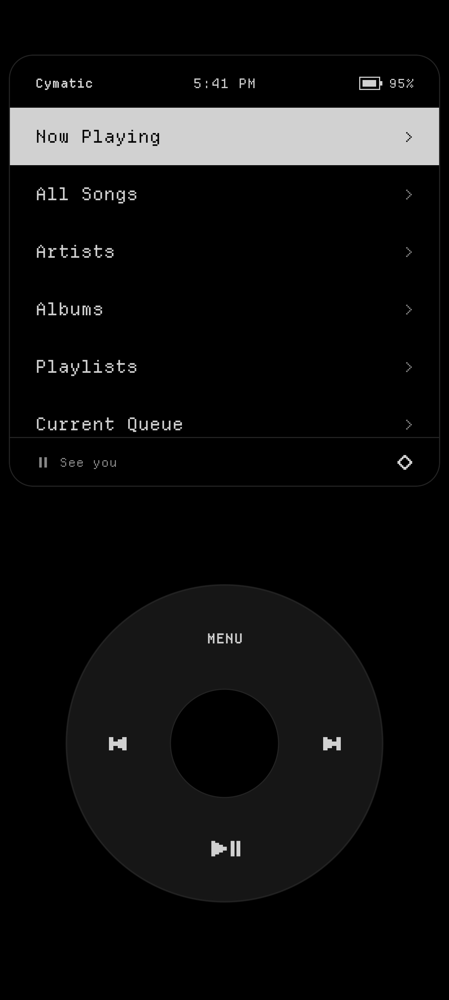
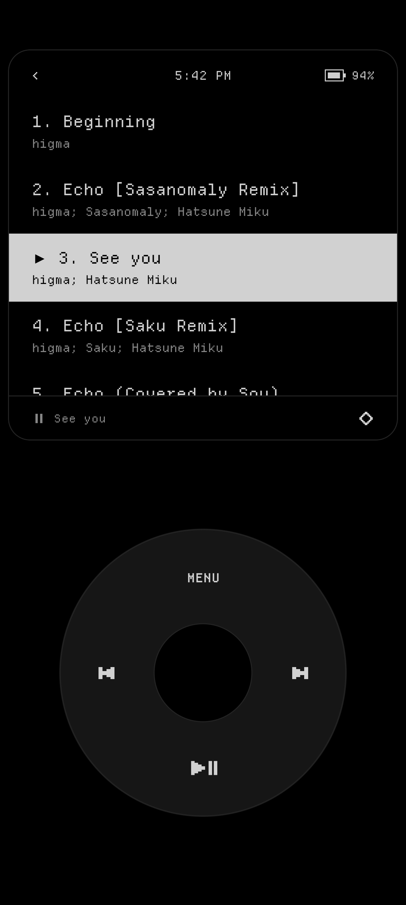
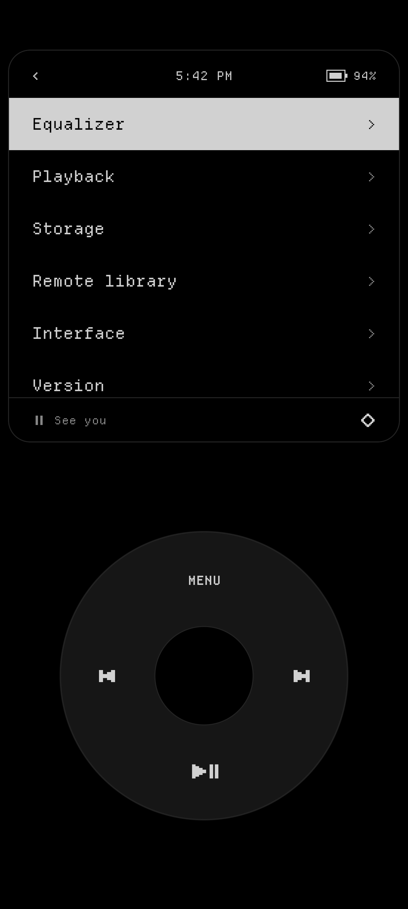

# Cymatic

A minimal Android music player with a classic click wheel, monochrome pixel interface, and direct USB DAC playback.

**[Download the latest APK](https://github.com/PXR05/cymatic/releases/latest)** · Requires Android 12 or newer

## Screenshots

| Now Playing | Main Menu |
| --- | --- |
|  |  |

| Track Queue | Settings |
| --- | --- |
|  |  |

## Highlights

- **Click wheel navigation:** Spin the outer ring to scroll lists or adjust volume, or tap items directly.
- **Minimal pixel UI:** Monochrome light and dark themes with crisp pixel icons and customizable wheel size, sensitivity, padding, haptics, text scrolling, cover art, and screen-awake behavior.
- **Standby mode:** Optional idle timeout blanks the screen to reduce distractions. Touch anywhere to wake it, and continue smoothly into a wheel gesture.
- **Local & remote music together:** Browse tracks, artists, albums, playlists, and your queue in one place, or connect an AudioStream account to stream your remote library.
- **Per-device audio profiles:** Automatically remembers volume (with separate normal and direct USB levels) and equalizer presets for each output device, including hardware PEQ on supported USB DACs.
- **Direct USB DAC & DSD support:** Bypass Android audio mixing on compatible USB DACs, with support for lossless formats and DSD (PCM conversion or bit-perfect DoP).

## Getting started

1. **Install:** Download `cymatic-player-v<version>.apk` from [GitHub Releases](https://github.com/PXR05/cymatic/releases/latest) and install it on your Android 12+ device.
2. **Learn the click wheel:** On first launch, Cymatic walks you through spinning the wheel, opening items with the center button, and going back with Left or Menu. You can also tap **Skip** at any time.
3. **Choose your music source:**
   - **On this device:** Allow music access so Cymatic can scan your library automatically (or pick a music folder if no tracks are found).
   - **AudioStream:** Enter your server URL, username, and password to load your remote songs and playlists. *(Local storage permission is only needed if you also play files on your device.)*
4. **Start listening:** Once your library is ready, press Center to open **All Songs**. You can manage folders, connect another source, or customize the wheel and display later under **Settings**.

## Controls

Slide around the outer ring to scroll through lists, or to adjust volume on the **Now Playing** screen. You can also tap list items directly.

| Button | Browsing | Now Playing |
| --- | --- | --- |
| **Center** | Select highlighted item | Return to library |
| **Menu** | Return to main menu | Return to main menu |
| **Previous** | Go back | Previous track |
| **Next** | Select highlighted item | Next track |
| **Play/Pause** | Open Now Playing | Play / Pause |

**Long-press shortcuts:**
- **Hold Menu** for quick settings.
- **Hold Center** while browsing to open actions for the highlighted item.
- **Hold Center** on Now Playing for track actions, including **Output info** to view playback/USB details or copy a diagnostic report (**Copy report**).

## Direct USB DAC & DSD playback

Plug in a USB DAC, enable **Settings → Playback → USB audio → Direct USB**, and allow USB access when prompted. A hollow diamond icon indicates that direct USB output is active.

- **Supported formats:** WAV, FLAC (including Ogg FLAC), ALAC (M4A/MP4), MP3, Ogg Vorbis/Opus, and DSF. If a track or DAC configuration isn't supported over direct USB, Cymatic automatically falls back to standard Android playback.
- **DSD playback (DSF):** Supports DSD64, DSD128, DSD256, and DSD512 (including 48 kHz-family rates). Standard playback converts DSD to high-res PCM. Over direct USB, Cymatic can send bit-perfect DoP for DSD64/128 on supported DACs, or convert to PCM otherwise.
- **Per-DAC DSD setting:** Configure **Settings → Playback → USB audio → DSD output** as **Automatic**, **Convert to PCM**, or **DoP** for each DAC. **Automatic** recognizes Amanero Combo384 interfaces and uses PCM for unknown DACs; choose **DoP** if your DAC supports it. If DoP fails, Cymatic retries with PCM and falls back to Android output if needed.
- **Missing DSF files?** If Android doesn't index your DSF files automatically, add their folder under **Settings → Storage → Add directory** and rescan. Cymatic reads DSF tags and embedded cover art directly.

## Credits

- **Audio codecs:** [libFLAC](https://xiph.org/flac/), [Apple ALAC](https://github.com/macosforge/alac)
- **USB DAC PEQ:** [Contour](https://github.com/Chronosauros/contour) (with protocols from [devicePEQ](https://github.com/jeromeof/devicePEQ) and [FreeDSP-Studio](https://github.com/EffectiveEquivalent/FreeDSP-Studio))
- **Fonts:** [Departure Mono](https://departuremono.com/), [LanaPixel](https://opengameart.org/content/lanapixel-localization-friendly-pixel-font), [JetBrains Mono](https://github.com/JetBrains/JetBrainsMono)

Full third-party notices and license texts are available inside the app.

---

## Building from source

See [docs/development.md](docs/development.md) for setup, module layout, and build instructions.
