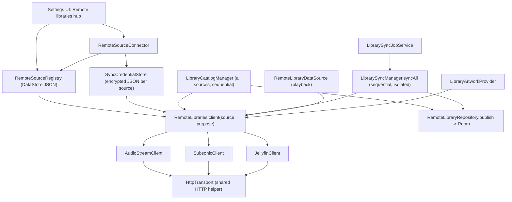

# Multi-source remote library: implementation plan

Status: approved design, not started · Scope: `:shared:music` + `:app` · Providers: AudioStream (existing), **Subsonic/OpenSubsonic**, **Jellyfin**

## 0. Decisions

### 0.1 Decided with the owner

| # | Topic | Decision |
|---|---|---|
| D1 | Source identity | Each source gets a stable random ID (64 lowercase hex chars, from 32 bytes of `SecureRandom`). The existing AudioStream source **keeps its current hash ID**, so no data migration is needed. Editing a URL never changes the ID. |
| D2 | Registry storage | A JSON list in the existing Preferences DataStore (`SettingsStore`). No Room schema change. |
| D3 | Settings scope | **Per source:** enabled, content mode, selected playlists, content-configured flag, last result/time, streaming quality. **Global:** network, interval, folder layout, one download folder (SAF root), with one subfolder per source. |
| D4 | Library presentation | One merged library, a source filter (All / This device / each source), and the source name in Song Info. No duplicate detection across sources. |
| D5 | Auth | Use an API key when one is available (OpenSubsonic `apiKey`, Jellyfin API key). Otherwise store the password (encrypted) and **re-authenticate automatically** (Jellyfin: re-login on 401; Subsonic: salted token on every request). |
| D6 | Quality | Stream the original file by default (`format=raw` / `static=true`). Optional per-source setting: "transcode on metered network" at a chosen bitrate. Offline downloads always get the original file. |
| D7 | Playlists | Read-only mirror (as today). Users can copy a remote playlist into a local one. |
| D8 | Delivery | Phases: (1) multi-source refactor with AudioStream only → (2) Subsonic → (3) Jellyfin → (4) source filter and polish. Each phase can ship on its own. |

### 0.2 Decided by the planner (review these)

| # | Topic | Decision | Why |
|---|---|---|---|
| P1 | Cleartext HTTP | Add `network_security_config.xml` that allows cleartext traffic and trusts **user-installed CAs**. The connection form shows a warning when `http://` is used with a non-private host. | Self-hosted Navidrome/Jellyfin usually run on `http://192.168.x.x` or use self-signed certificates. Right now the app has no network security config, so on targetSdk ≥ 28 any `http://` server fails. |
| P2 | Transcode format | MP3 only (128/192/256/320 kbps). | MP3 CBR is the only format both servers produce reliably, and ExoPlayer can seek in it with constant-bitrate seeking. Opus/Ogg seeking over an unranged stream is poor. |
| P3 | Jellyfin libraries | All `CollectionType == "music"` libraries are included. No library picker in v1. | Keeps the setup short on the click-wheel UI. A picker can be added later through `extras`. |
| P4 | Concurrency | One sync or refresh at a time, process-wide. Sources are handled **one after another**; if one source fails, the others still run. | Matches the current `running` lock and keeps a single progress UI and bandwidth use predictable. |
| P5 | Out of scope | Quick Connect, two-way playlists, duplicate merging, Room-backed catalogs, cloud drives, WebDAV/SMB. | n/a |

---

## 1. Current state (what is single-source today)

Already multi-source-ready:
- `RemoteLibraryItemKey(sourceId, remoteId).audioId()` gives negative, collision-free Room IDs ([RemoteLibraryIdentity.kt](../shared/music/src/main/java/com/pxr/cymatic/sync/RemoteLibraryIdentity.kt)).
- Playback URIs `cymatic://<sourceId>/<remoteId>` are resolved per source in [RemoteLibraryDataSource.kt](../shared/music/src/main/java/com/pxr/cymatic/sync/RemoteLibraryDataSource.kt).
- Catalog files `library-catalogs/<sourceId>.json`, managed downloads `library-downloads/<sourceId>/`, offline pins `library-offline` prefs `<sourceId>_tracks|_playlists`, credentials `password_<sourceId>`, and playlist mappings `SYNC_PLAYLIST_IDS_<sourceId>` are all keyed by source ID.
- `AudioEntity.sourceId/remoteId/offlineUri` and `PlaylistEntity.sourceId/remoteId` already exist ([AudioEntities.kt](../shared/music/src/main/java/com/pxr/cymatic/data/media/AudioEntities.kt)).

Single-source assumptions to remove:

| Where | Assumption |
|---|---|
| [RemoteLibrarySource.kt](../shared/music/src/main/java/com/pxr/cymatic/sync/RemoteLibrarySource.kt) | `id` is computed as `SHA-256(provider, normalized endpoint, account)`, so changing the URL gives a new ID. |
| [RemoteLibraries.kt](../shared/music/src/main/java/com/pxr/cymatic/sync/RemoteLibraries.kt) | `currentSource()` / `cachedCurrentSource()` read the single `SYNC_URL/SYNC_USERNAME/SYNC_ADAPTER`; `client()` only knows `audiostream` + password. |
| [LibrarySyncSettings.kt](../shared/music/src/main/java/com/pxr/cymatic/data/store/LibrarySyncSettings.kt) | Global `SYNC_URL`, `SYNC_USERNAME`, `SYNC_ADAPTER`, `SYNC_CONTENT_MODE`, `SYNC_CONTENT_CONFIGURED`, `SYNC_SELECTED_PLAYLISTS`, `SYNC_LAST_TIME`, `SYNC_LAST_RESULT`. `setSyncConnection` hard-codes `audiostream`. Defaults `DEFAULT_SYNC_URL`/`DEFAULT_SYNC_USERNAME` mean the "current source" always exists, even when nothing is configured. |
| [SyncCatalogStore.kt](../shared/music/src/main/java/com/pxr/cymatic/sync/SyncCatalogStore.kt) | `source(context, id)` rebuilds the source from the catalog file and checks `it.id == sourceId`, which breaks once IDs are no longer hashes. |
| [LibrarySyncManager.kt](../shared/music/src/main/java/com/pxr/cymatic/sync/LibrarySyncManager.kt) | `current` flag: content mode, selected playlists, and SAF directory only apply to the current source. The manifest checkpoint identity is `provider/address/account/directory`. Retries check `AudioStreamRequestException`. |
| [LibraryCatalogManager.kt](../shared/music/src/main/java/com/pxr/cymatic/sync/LibraryCatalogManager.kt) | Refreshes only `currentSource()`. |
| [LibrarySyncJobService.kt](../shared/music/src/main/java/com/pxr/cymatic/sync/LibrarySyncJobService.kt) | Eligibility and sync only for `currentSource()`. |
| [LibraryOfflineManager.kt](../shared/music/src/main/java/com/pxr/cymatic/sync/LibraryOfflineManager.kt) | Auto-enables Wi-Fi sync only when `sourceId == currentSource().id`. |
| [RemoteLibraryRepository.kt](../shared/music/src/main/java/com/pxr/cymatic/sync/RemoteLibraryRepository.kt) | `restore()` publishes every catalog file on disk. SAF offline detection only for the current source. Playlist disambiguation uses the URL host. |
| [SyncCredentialStore.kt](../shared/music/src/main/java/com/pxr/cymatic/sync/SyncCredentialStore.kt) | One encrypted password string per source. |
| [AudioStreamConnection.kt](../shared/music/src/main/java/com/pxr/cymatic/sync/AudioStreamConnection.kt) | Connection save is AudioStream-only and writes the global settings. |
| [LibraryArtworkProvider.kt](../shared/music/src/main/java/com/pxr/cymatic/sync/LibraryArtworkProvider.kt) | `openArtwork(trackId)` uses the track ID. Subsonic needs a separate `coverArt` ID. A new client (and so a login) is created for every artwork load. |
| [CymaticApp.kt](../shared/music/src/main/java/com/pxr/cymatic/CymaticApp.kt) | Warms the cache for `currentSource()` only. |
| App UI: [LibrarySyncSettingsViewModel.kt](../app/src/main/java/com/pxr/cymatic/ui/screens/settings/sync/LibrarySyncSettingsViewModel.kt), [LibrarySyncSettingsScreen.kt](../app/src/main/java/com/pxr/cymatic/ui/screens/settings/sync/LibrarySyncSettingsScreen.kt), [LibrarySyncSettingsState.kt](../app/src/main/java/com/pxr/cymatic/ui/screens/settings/sync/LibrarySyncSettingsState.kt), [AllSongsScreen.kt](../app/src/main/java/com/pxr/cymatic/ui/screens/library/AllSongsScreen.kt), [MusicSetupViewModel.kt](../app/src/main/java/com/pxr/cymatic/setup/MusicSetupViewModel.kt), [MusicSetupStore.kt](../app/src/main/java/com/pxr/cymatic/setup/MusicSetupStore.kt), [BugReport.kt](../app/src/main/java/com/pxr/cymatic/ui/screens/settings/BugReport.kt) | All read the single URL/username/password and the current source. |

There are no unit tests in the repo yet (no JUnit in `gradle/libs.versions.toml`).

---

## 2. Target architecture



### 2.1 Core types (in `com.pxr.cymatic.sync`)

```kotlin
enum class RemoteProvider(val value: String, val label: String, val supportsTranscoding: Boolean) {
    AUDIOSTREAM("audiostream", "AudioStream", false),
    SUBSONIC("subsonic", "Subsonic", true),
    JELLYFIN("jellyfin", "Jellyfin", true);
    companion object { fun from(value: String) = entries.firstOrNull { it.value == value } }
}

// Runtime identity passed around by sync/playback code (replaces the old 3-arg class).
data class RemoteLibrarySource(
    val id: String,              // 64 lowercase hex
    val provider: String,        // RemoteProvider.value
    val address: String,         // normalized base URL, trailing '/'
    val account: String,         // username shown in UI
    val displayName: String,
    val extras: Map<String, String> = emptyMap(),
) {
    fun itemKey(remoteId: String) = RemoteLibraryItemKey(id, remoteId)
    companion object {
        fun legacyId(provider: String, address: String, account: String): String // EXACT copy of today's hash algorithm
        fun newId(): String // SecureRandom 32 bytes -> lowercase hex
    }
}

// Persisted per-source configuration (registry entry).
data class RemoteSourceConfig(
    val id: String,
    val provider: String,
    val displayName: String,
    val address: String,
    val account: String,
    val enabled: Boolean = true,
    val folderName: String? = null,      // "" = SAF root (legacy source only); null = not yet assigned
    val contentMode: String = "none",    // SyncContentMode.value
    val contentConfigured: Boolean = false,
    val selectedPlaylists: Set<String> = emptySet(),
    val transcodeOnMetered: Boolean = false,
    val transcodeBitrateKbps: Int = 192,  // 128 | 192 | 256 | 320
    val lastSyncTime: Long = 0L,
    val lastSyncResult: String = "Not synced yet",
    val lastError: String? = null,        // "auth" | "unreachable" | null, for status line
    val extras: Map<String, String> = emptyMap(),
    val createdAt: Long,
) { fun toSource() = RemoteLibrarySource(id, provider, address, account, displayName, extras) }

data class RemoteCredentials(
    val password: String? = null,
    val apiKey: String? = null,
    val accessToken: String? = null,   // Jellyfin session token
    val userId: String? = null,        // Jellyfin user id
)

enum class ClientPurpose { CATALOG, DOWNLOAD, STREAM, ARTWORK }
sealed interface StreamQuality { data object Original : StreamQuality; data class Mp3(val kbps: Int) : StreamQuality }
```

New IDs use the same `[a-f0-9]{64}` format as the hash IDs. That keeps the existing validation in `SyncCatalogStore.file()` and `LibraryArtworkProvider.openFile()` working unchanged.

### 2.2 `RemoteLibraryClient` interface changes ([RemoteLibrarySource.kt](../shared/music/src/main/java/com/pxr/cymatic/sync/RemoteLibrarySource.kt))

```kotlin
interface RemoteLibraryClient {
    fun getTracks(): List<RemoteTrack>
    fun getPlaylists(): List<RemotePlaylist>
    fun openDownload(trackId: String): RemoteLibraryDownload                    // always original bytes
    fun openArtwork(trackId: String, artworkId: String?): RemoteLibraryDownload  // artworkId from RemoteTrack
    fun openStream(trackId: String, position: Long, length: Long,
                   quality: StreamQuality = StreamQuality.Original): RemoteLibraryDownload
    fun cancel()
}
```

Rename `AudioStreamRequestException` to `RemoteRequestException(status, retryAfterMillis, message)`. Update the retry check in `LibrarySyncManager.downloadTrack` and the mapping in `connectionError()`.

### 2.3 `RemoteTrack` additions ([SyncModels.kt](../shared/music/src/main/java/com/pxr/cymatic/sync/SyncModels.kt))

Add these optional fields, all defaulting to `null`: `artworkId: String?`, `albumArtist: String?`, `discNumber: Int?`, `bitDepth: Int?`, `channels: Int?`, `year: Int?`. Read and write them as optional keys in `SyncCatalogStore` (keep reading old files). Write `metadataVersion = 3`. `needsMetadataRefresh` stays `< 2`, so AudioStream users don't get a forced refresh.

`bitRate` units: check what AudioStream returns and what `AudioInfoFormatting` expects (bps vs kbps). Make all providers produce the same unit. Subsonic `bitRate` is **kbps**; Jellyfin `Bitrate` is **bps**.

---

## 3. Phase 1: multi-source refactor (AudioStream only)

Goal: the app works exactly as before for existing users. It can also hold any number of AudioStream sources, edit or remove each one, and sync them all.

### 1.1 Source model
- Change `RemoteLibrarySource` as in §2.1. Move today's hash into `legacyId()` **byte-for-byte** (normalisation, default port stripping, `"$provider\n$endpoint\n${account.trim()}"`).
- Add `RemoteProvider`, `RemoteSourceConfig`, `RemoteCredentials`, `ClientPurpose`, `StreamQuality`.
- Every `RemoteLibrarySource(provider, address, account)` call site has to change: `RemoteLibraries`, `SyncCatalogStore.source`, `AudioStreamConnection`.

### 1.2 `RemoteSourceRegistry` (new: `shared/music/src/main/java/com/pxr/cymatic/data/store/RemoteSourceRegistry.kt`)
- DataStore keys: `REMOTE_SOURCES` (string, JSON `{"v":1,"sources":[...]}`), `REMOTE_SOURCES_MIGRATED` (boolean), `REMOTE_DEVICE_ID` (string, random UUID generated once; Jellyfin uses it as DeviceId).
- API:
  - `val sourcesFlow: Flow<List<RemoteSourceConfig>>` (sorted by `createdAt`)
  - `val currentSources: List<RemoteSourceConfig>` (read synchronously from `SettingsStore.currentPreferences`, same pattern as `LibrarySyncSettings.current*`)
  - `suspend fun all()`, `suspend fun get(id)`, `fun cached(id)`
  - `suspend fun add(config)`, `suspend fun update(id, transform: (RemoteSourceConfig) -> RemoteSourceConfig)`, `suspend fun remove(id)`
  - `suspend fun setResult(id, time, message, lastError)`
  - `suspend fun deviceId(): String`
- The JSON codec must be lenient: ignore unknown keys and use defaults for missing ones. Never throw while decoding one entry; skip it and log a warning.

### 1.3 Legacy migration (new: `sync/RemoteSourceMigration.kt`)
Call `RemoteSourceMigration.migrate(context)` from `CymaticApp` **before** `RemoteLibraryRepository.restore`. Also call it lazily from `RemoteSourceRegistry.all()` if the migrated flag is missing (the UI may read the registry first). Guard it with a `Mutex` and make it idempotent.

1. If `REMOTE_SOURCES_MIGRATED == true`, return.
2. Compute the effective legacy source from `LibrarySyncSettings.getSyncAdapter()/getSyncUrl()/getSyncUsername()`, **including defaults**, because that is the ID the current app uses. `id = legacyId(...)`. Skip this step if the URL or username is blank (MusicSetupStore writes `""` when skipping remote setup).
3. Run `SyncCredentialStore.migrateLegacy(context, id)` and `SyncCatalogStore.migrateLegacy(context, source)` (existing functions).
4. Create a config for the current source only if at least one is true: credentials exist for `id`, `library-catalogs/<id>.json` exists, or Room has rows with `sourceId == id`. Values: `displayName` = URL host (fallback "AudioStream"); `folderName = ""` (root, so existing SAF files stay where they are); `contentMode`, `contentConfigured`, `selectedPlaylists`, `lastSyncTime`, `lastSyncResult` copied from the legacy keys.
5. **Older connections:** today `restore()` publishes *every* catalog file. To keep their songs visible, import each other `library-catalogs/*.json` file whose JSON has `provider/address/account` as its own config (`id` = file name, `enabled` = true, `folderName = null`). Without credentials they show "Sign in required" in the list, so the user can sign in or remove them.
6. Set `REMOTE_SOURCES_MIGRATED = true`. **Do not delete the legacy keys in Phase 1**, so downgrade still works. Phase 4 deletes them.

Global keys that stay global: `SYNC_NETWORK`, `SYNC_INTERVAL_HOURS`, `SYNC_LAYOUT`, `SYNC_DIRECTORY`. `SYNC_LAST_TIME/RESULT` stays as a "last run" summary for the global Downloads page.

### 1.4 Credentials ([SyncCredentialStore.kt](../shared/music/src/main/java/com/pxr/cymatic/sync/SyncCredentialStore.kt))
- New storage key `secret_<id>`: AES-GCM encrypted JSON of `RemoteCredentials`, using the same keystore key and cipher code as today.
- `get(context, id)`: read `secret_<id>`; if it's missing, fall back to legacy `password_<id>` → `RemoteCredentials(password = it)`.
- New API: `save(context, id, creds)`, `get(context, id): RemoteCredentials?`, `has(context, id)`, `cachedHas(id)`, `updateSession(context, id, accessToken, userId)` (keeps password/apiKey), `delete(context, id)` (removes both keys and clears the presence cache).
- Remove `savePassword/getPassword/hasPassword/cachedHasPassword` after updating callers. Callers: `RemoteLibraries`, `AudioStreamConnection`, `RemoteLibraryRepository`, `LibrarySyncJobService`, `CymaticApp`, `LibrarySyncSettingsViewModel`, `AllSongsScreen`, `MusicSetupViewModel`, `MusicSetupStore`.
- `has()` means "can authenticate": `apiKey != null || password != null || accessToken != null`.

### 1.5 `RemoteLibraries` ([RemoteLibraries.kt](../shared/music/src/main/java/com/pxr/cymatic/sync/RemoteLibraries.kt))
- Remove `currentSource()` and `cachedCurrentSource()`.
- Add `suspend fun source(id): RemoteLibrarySource?` and `fun cachedSource(id)`, both backed by the registry.
- `fun client(context, source, purpose = ClientPurpose.CATALOG): RemoteLibraryClient` dispatches on `RemoteProvider.from(source.provider)`. AudioStream needs `credentials.password`; Subsonic/Jellyfin come in Phase 2/3. Throw `IllegalStateException("Sign in to <displayName> first")` when credentials are missing.
- **Client cache for artwork and streaming:** keep a process-wide `ConcurrentHashMap<String, RemoteLibraryClient>` for `ARTWORK`/`STREAM`. Invalidate the entry when the config or credentials change (registry `update` and credential `save` call `RemoteLibraries.invalidate(id)`). Never call `cancel()` on cached clients. `CATALOG`/`DOWNLOAD` always get a fresh client, because sync cancels them. This stops a login per cover image.

### 1.6 `SyncCatalogStore`
- `source(context, id)` delegates to `RemoteLibraries.cachedSource(id) ?: runBlocking-free suspend variant`. Remove the hash reconstruction and the `it.id == sourceId` check. Keep writing `provider/address/account/sourceId` into the file (diagnostics + migration).
- Add `fun track(context, sourceId, remoteId): RemoteTrack?`, backed by a lazily built `Map<String, RemoteTrack>` per source, cached next to `catalogs` and rebuilt on `write`.
- Add `fun delete(context, sourceId)`: removes the file and evicts the caches.

### 1.7 Storage per source
- New `sync/PrefixedSyncStorage.kt`: `internal class PrefixedSyncStorage(private val base: SyncStorage, private val prefix: String) : SyncStorage`. Every method maps `relativePath` → `"$prefix/$relativePath"`. `copy()` maps both paths.
- New helper `SyncStorages.forSource(context, config, directory): SyncStorage`:
  - `directory.isBlank()` → `ManagedSyncStorage(File(filesDir, "library-downloads/${id}"))`
  - `config.folderName == ""` → `SafTree(root)` (legacy source)
  - otherwise → `PrefixedSyncStorage(SafTree(root), folderName)`
- **Assigning `folderName`:** do it when a source is created, and lazily for imported configs with `null`. Use the display name cleaned by the same rules as `SyncPathPlanner.safeSegment` (make that helper `internal` and reusable). Make it unique, case-insensitively, against other configs' `folderName`s. If the folder already exists in the tree and its `.cymatic-sync.json` has a different `sourceId`, append ` 2`, ` 3`, and so on. Persist it with `registry.update`.
- Use `forSource` in `LibrarySyncManager.syncBlocking` and in `RemoteLibraryRepository.publish` (offline detection for **every** source when a SAF directory is set, not only the current one).
- Known, accepted edge case: the legacy source syncs into the root, so an artist folder could share a name with a new source's folder. Manifest ownership checks and different path depths keep this harmless. Document it, don't build anything for it.

### 1.8 Sync manifest checkpoint identity ([SyncManifestStore.kt](../shared/music/src/main/java/com/pxr/cymatic/sync/SyncManifestStore.kt))
- New identity: `"source:${id}\n${directory}\n${folderName}"`.
- Add `companion fun forSource(context, source, directory, folderName, legacyIdentity: String)`. If the new file is missing and the legacy identity file exists (the old string `(if provider == "audiostream" "" else "$provider\n") + "$address\n$account\n$directory"`), copy it first.
- Add `fun delete()` for source removal.

### 1.9 Orchestration
**LibraryCatalogManager**
- `fun refresh(context, sourceId: String? = null): Boolean`. `null` means every `enabled` source that has credentials, refreshed one after another. Wrap each source in try/catch: record the failure (`registry.setResult(..., lastError = "auth"|"unreachable")`) and continue.
- `CatalogProgress` becomes `Refreshing(sourceName: String?, index: Int, total: Int)`, `Complete(refreshed: List<RemoteLibrarySource>, failures: Map<String, String>)`, `Failed(message)` (only when *all* sources failed or there were none), `Cancelled`, `Idle`.
- Update consumers: `LibrarySyncSettingsViewModel`, `MusicSetupScreen`, `AllSongsScreen`, `BugReport`, `AudioStreamConnection`/connector.

**LibrarySyncManager**
- `syncBlocking(context, source)` reads `contentMode`, `selectedPlaylists`, and `folderName` from the source's `RemoteSourceConfig`. Remove the `current` flag. The SAF directory applies to all sources.
- New `suspend fun syncAll(context): SyncSummary`. Iterate over eligible sources (see `SyncEligibility`) in order. Isolate each source's failure, keep going, and add up the summaries. Write per-source results with `registry.setResult` and a global summary with `LibrarySyncSettings.setSyncResult` (e.g. `"Synced 2 libraries · 1 failed: <name>: <reason>"`).
- `start(context, sourceId: String? = null)`: `null` → `syncAll`.
- Add `sourceName: String? = null` to `SyncProgress.Preparing` and `Downloading` so the UI can show which library is syncing.
- Keep the single `running` lock (P4).

**SyncEligibility** (new): `isEligible(context, config, pins) = config.enabled && credentials.has && (pins non-empty || (config.contentConfigured && mode != NONE && !(mode == SELECTED_PLAYLISTS && selectedPlaylists.isEmpty())))`.

**LibrarySyncJobService**
- `onStartJob` → `LibrarySyncManager.syncAll`.
- `reschedule()`: return early if network is NEVER, or if a SAF directory is set without persisted permission. Otherwise schedule only when **at least one** source is eligible.
- `shouldRetry` = at least one source failed for a reason other than cancellation.

**LibraryOfflineManager.request**: replace the `currentSource()` check with the source's config. If `!config.contentConfigured && network == NEVER` → set network to WIFI. Then reschedule.

**RemoteLibraryRepository**
- `restore()`: iterate the registry (not the folder). Publish each cached catalog. For sources with `needsMetadataRefresh` and credentials → `LibraryCatalogManager.refresh(context, id)`. Delete catalog files that have no registry entry (orphans from an interrupted removal).
- Playlist name disambiguation: use `config.displayName` instead of the URL host.

**CymaticApp**: after migration, warm the caches (`SyncCredentialStore.has`, `OfflineSelectionStore.read`, `SyncCatalogStore.read`) for every registry source.

### 1.10 Connecting and editing (`sync/RemoteSourceConnector.kt`, replaces `AudioStreamConnection`)
```kotlin
data class ConnectionInput(
    val provider: RemoteProvider, val address: String, val username: String,
    val password: String, val apiKey: String, val displayName: String,
    val existingId: String? = null,
)
class RemoteSourceConnector(context: Context, input: ConnectionInput) {
    fun cancel()
    suspend fun connect(): RemoteSourceConfig
}
```
- Steps: normalize the URL (provider-specific) → validate the fields → resolve credentials (an empty password/apiKey while editing means "keep the stored one") → `provider.verify(...)` (AudioStream: `authenticate()`; Subsonic/Jellyfin: §4/§5), which returns the server name and extras → refuse if a sync or refresh is running → save credentials → `registry.add` or `update` → `RemoteLibraries.invalidate(id)` → `LibraryCatalogManager.refresh(context, id)`.
- **Edit rules** (the ID never changes):
  - Address or display name changed → keep everything.
  - Username changed → keep the ID, but run `RemoteSourceRemover.clearData(id)` (§1.11, without removing the config or credentials) and reset `contentMode/contentConfigured/selectedPlaylists`.
  - Provider can't be changed on edit.
- Keep `connectionError(error)` and make it provider-aware (e.g. "Subsonic was not found at this address"). Messages must **never include URLs or query strings** (Subsonic auth goes in the query).

### 1.11 Removing a source (`sync/RemoteSourceRemover.kt`)
`suspend fun remove(context, sourceId, deleteDownloads: Boolean)`. `clearData(context, sourceId)` is a public part of it.
1. `registry.update(enabled = false)` so the job and refreshes skip it.
2. If a sync or refresh is running for this source → cancel it and wait up to 5 s for `isRunning == false`.
3. Collect `audioIds = audioDao.getRemoteAudio(sourceId).map { it.id }`.
4. In a Room transaction: delete the playlists with this `sourceId` (new DAO `@Query("DELETE FROM playlists WHERE sourceId = :sourceId")`), then the audio rows (new DAO `@Query("DELETE FROM audio_files WHERE sourceId = :sourceId")`). Local playlist items that point at these songs are removed by the FK cascade. The UI copy must warn about this.
5. Files:
   - Managed storage: always delete `library-downloads/<id>` recursively (the user can't reach it otherwise).
   - SAF, `deleteDownloads = true`: delete every path in the source's manifest, then the manifest, then the folder if it's empty and `folderName` isn't blank.
   - SAF, `deleteDownloads = false`: leave the files. They show up again as local music through the MediaStore scan. UI copy: "Downloaded files in your folder are kept".
6. Delete: catalog file (`SyncCatalogStore.delete`), manifest checkpoint, artwork cache files `library-artwork/<audioId>-*.img` for the collected IDs, `OfflineSelectionStore.clear(id)` (new), `LibrarySyncSettings.clearSyncPlaylistIds(id)` (new; removes `SYNC_PLAYLIST_IDS_<id>`), `SyncCredentialStore.delete`, `RemoteLibraries.invalidate`, and finally `registry.remove(id)` (skip this last step in `clearData`).
7. `AudioRepository.invalidate()`, `PlaylistRepository.invalidate()`, `LibraryChanges.notifyChanged()`, `LibrarySyncJobService.reschedule()`.
- Known, accepted limitation: queue items from a removed source fail with "This library connection is unavailable" when played.

### 1.12 Network security (P1)
- Add `shared/music/src/main/res/xml/network_security_config.xml` (or in `:app`, wherever the `<application>` merge works best): `<base-config cleartextTrafficPermitted="true"><trust-anchors><certificates src="system"/><certificates src="user"/></trust-anchors></base-config>`. Reference it with `android:networkSecurityConfig` on `<application>`.
- Connection form: when the scheme is `http` and the host is not private (RFC 1918, `.local`, link-local, loopback, Tailscale `100.64.0.0/10`), show the warning "Your password is sent unencrypted".

### 1.13 UI (`:app`)
**Navigation** ([Screen.kt](../app/src/main/java/com/pxr/cymatic/ui/navigation/Screen.kt), [MusicNavHost.kt](../app/src/main/java/com/pxr/cymatic/ui/navigation/MusicNavHost.kt); keep everything inside `SyncGraph`):

| Route | Page |
|---|---|
| `setting/library-sync` (existing) | **Remote libraries hub**: one row per source (title `displayName`, subtitle `"<Provider> · <account>@<host> · <status>"`), "Add library", "Downloads" (global status), "Advanced" (global: folder, layout, schedule), "Help" |
| `setting/library-sync/add` | Provider picker: AudioStream, Subsonic / Navidrome, Jellyfin (Phase 1: AudioStream only) |
| `setting/library-sync/add/{provider}` | Connection form for a new source |
| `setting/library-sync/source/{sourceId}` | Source page: Connection, Library, Bulk downloads, Streaming quality (Phase 2+, hidden if `!supportsTranscoding`), Enabled on/off, Remove library |
| `.../source/{sourceId}/connection` | Edit connection (existing `SyncConnectionPage`, extended with provider-specific fields) |
| `.../source/{sourceId}/library` | Existing `SyncRemoteLibraryPage`, scoped to the source |
| `.../source/{sourceId}/bulk` and `/playlists` | Existing bulk download and playlist pages, scoped to the source |
| `.../source/{sourceId}/remove` | Confirmation: "Remove, keep downloaded files" / "Remove library and downloads" / Cancel, plus the playlist warning |

Build routes with the existing route-pattern helper in `Screen.kt` (the `replace(match.value, Uri.encode(value))` function).

**ViewModels**
- `LibrarySyncSettingsViewModel` (graph-scoped, as today) keeps the global state: the source list (from `sourcesFlow`), network, interval, layout, directory, `SyncProgress`, `CatalogProgress`.
- New `RemoteSourceViewModel(sourceId)` (created with `SavedStateHandle` from the route argument) owns what moves out of `LibrarySyncSettingsState`: `url`, `username`, `hasCredentials`, `catalog`, `contentMode`, `musicConfigured`, `selectedPlaylists`, `hasPinnedMusic`, plus `transcode*` and `enabled`. Its actions: `saveConnection`, `setContentMode`, `setPlaylists/commitPlaylists`, `refreshLibrary` (→ `refresh(context, id)`), `startSync` (→ `start(context, id)`), `setTranscode`, `setEnabled`, `remove`.
- `nextStep` logic moves per source. The global "Download now" button runs `syncAll`.

**Other screens**
- `AllSongsScreen` lines ~50–180: `remoteConnected` = any enabled source has credentials. Retry or pull-to-refresh → `refresh(context)` (all sources).
- `MusicSetupStore` (~L39–45): replace the `currentSource()` check with `registry.all().isNotEmpty()`, and stop calling `setSyncConnection("", "", true)`. `MusicSetupViewModel`: create the source through `RemoteSourceConnector` (AudioStream in Phase 1; add a provider choice step in Phase 3).
- `BugReport`: list sources as provider, a hash of the host, enabled, `lastError`, catalog size. No secrets or URLs.

### 1.14 Test infrastructure (first commit of Phase 1)
- `gradle/libs.versions.toml`: `junit = "4.13.2"`, `mockwebserver = "4.12.0"` (`com.squareup.okhttp3:mockwebserver`), `orgjson = "20240303"` (`org.json:json`, needed because Android's `org.json` is a stub in JVM tests).
- `shared/music/build.gradle.kts`: `testImplementation(libs.junit)`, `testImplementation(libs.mockwebserver)`, `testImplementation(libs.orgjson)`, plus `android { testOptions { unitTests.isReturnDefaultValues = true } }`.
- Client classes must not touch Android APIs other than `android.util.Log`. Inject device name, app version, and device ID.
- Phase 1 unit tests: `legacyId` gives exactly today's values (hard-code 2 known vectors computed with the current code before changing it), registry JSON round-trip and lenient decoding, migration decision table (with faked inputs), `PrefixedSyncStorage` path mapping, `SyncEligibility`.

### Phase 1 acceptance
- `.\gradlew :shared:music:testDebugUnitTest :app:assembleDebug` passes.
- **Upgrade test (most important):** install the previous release, connect AudioStream, download some tracks to managed storage *and* (separately) to a SAF folder, pin one playlist, and add remote tracks to a local playlist. Upgrade. All songs, offline badges, pins, and local playlists are unchanged, and a manual sync reports everything as "unchanged" (nothing downloads again).
- Add a second AudioStream source: both libraries show up merged, and a duplicate playlist name gets the display-name suffix.
- Edit a source's URL: offline state and pins are kept.
- Change a source's username: its data is cleared and the ID stays the same.
- Remove a source both ways: the files behave as described, and no Room rows, catalog, credentials, or prefs keys are left behind.
- Make one source unreachable (wrong host): the background `syncAll` still syncs the other one, and the hub shows "Unreachable" for the broken one.
- `http://192.168.x.x` AudioStream connects (cleartext config).

---

## 4. Phase 2: Subsonic / OpenSubsonic

Targets: Navidrome, gonic, Airsonic-Advanced, Ampache (Subsonic API), LMS.

### 2.0 Shared HTTP helper (first step)
Pull `open()`, `checkResponse()`, `release()`, `cancel()`, the active-connection tracking, and the ranged-stream handling (the body of `AudioStreamClient.openStream`: Range header, `206`/`200` handling, `StreamRange.validateContentRange/skipFully/responseLength`) out into `sync/http/HttpTransport.kt`. Move `AudioStreamClient` onto it **without changing behaviour**, and re-run the Phase 1 acceptance checks for AudioStream playback, seek, and download.

### 2.1 `SubsonicClient` (`sync/subsonic/SubsonicClient.kt`)
- **Base URL:** normalize. If the user entered `.../rest` or `.../rest/`, strip it. Endpoint `"${base}rest/<method>"`. Common query: `v=1.16.1&c=Cymatic&f=json`.
- **Auth** on every request:
  1. `credentials.apiKey` exists and the server advertises the `apiKeyAuthentication` extension → `apiKey=<key>` (no `u`/`t`/`s`).
  2. Otherwise password → `u=<user>&s=<salt>&t=<md5(password + salt) lowercase hex>`, with a new 12-char random hex salt per request.
  3. Never send `p=`.
  - Auto re-auth (D5): if the API key is rejected (error 44, or 42 "not supported") and a password is stored → switch to token auth for this client and set `extras["apiKeyRejected"]="true"` with `registry.update`. Report "Sign in again" (`lastError = "auth"`) only when both fail.
- **Response envelope:** JSON root `subsonic-response` with `status` `"ok"|"failed"`, `error.code`, `error.message`. HTTP is 200 even on failure. Map error codes to `RemoteRequestException`: 40/41/44 → 401, 50 → 403, 70 → 404, 0/10/20/30 → 400.
- **Binary endpoints** (`stream`, `download`, `getCoverArt`): check `Content-Type` first. If it's `application/json` or `text/xml`, parse it as an error and throw. Don't treat it as audio.
- **Capabilities on connect:** `ping` must return ok. Then `getOpenSubsonicExtensions` (ignore failure → plain Subsonic). Store in extras: `openSubsonic` ("true"/"false"), `extensions` (comma list), `serverType` and `serverVersion` (envelope `type` / `serverVersion`). Default display name = `serverType` capitalised, or the host.
- **API key without username:** if only an API key is given and the server has OpenSubsonic, call `tokenInfo` and use the returned `username` as `account`.
- **getTracks():**
  - Main approach: `search3?query=&artistCount=0&albumCount=0&songCount=500&songOffset=N` (empty query = all songs on Navidrome and most OpenSubsonic servers). Loop while a page returns 500. Call `checkCancelled` between pages.
  - Fallback when the first page is empty: `getAlbumList2?type=alphabeticalByName&size=500&offset=N`, then `getAlbum?id=` for each album.
  - De-duplicate by `id`. Skip `isVideo == true`, and skip entries whose `type` is present and isn't `"music"`.
  - Mapping:

| RemoteTrack | Subsonic `child` |
|---|---|
| id | `id` |
| filename | last segment of `path`, or `"$title.$suffix"` |
| size | `size` (else -1) |
| updatedAt | `"${created}|${size}|${suffix}"` (Subsonic has no modified time) |
| title / artist / album | `title` / `artist` ?: "Unknown artist" / `album` ?: "Unknown album" |
| albumArtist | `displayAlbumArtist` ?: `albumArtist` (OpenSubsonic) |
| trackNumber / discNumber / year | `track` / `discNumber` / `year` |
| durationMs | `duration` × 1000 |
| bitRate | `bitRate` (kbps; convert to the unit chosen in §2.3) |
| sampleRate / bitDepth / channels | `samplingRate` / `bitDepth` / `channelCount` (OpenSubsonic) |
| artworkId | `coverArt` |

- **getPlaylists():** `getPlaylists`, then `getPlaylist?id=` for each, keeping `entry[].id` in order.
- **openDownload(id):** `download?id=` (original file). On error 50 (no download permission) → `stream?id=&format=raw`. Expect a full 200 body.
- **openStream(id, pos, len, quality):**
  - `Original` → `stream?id=&format=raw` with Range.
  - `Mp3(k)` → `stream?id=&format=mp3&maxBitRate=k&estimateContentLength=true`. If the server ignores Range, `HttpTransport` skips bytes (already supported).
- **openArtwork(id, artworkId):** `getCoverArt?id=${artworkId ?: id}&size=1024`.
- **Logging:** never log the request URL (it contains `t`/`s`/`apiKey`). Log the method name only.

### 2.2 Streaming quality (shared by Phase 2 and 3)
- Config: `transcodeOnMetered`, `transcodeBitrateKbps`. UI row "Streaming quality" with the choices "Original" / "MP3 128 / 192 / 256 / 320 kbps on mobile data". Hidden for AudioStream.
- **Where it's decided:** `RemoteLibraryDataSource.open()` for network opens:
  - At `position == 0`: quality = `Mp3(k)` if `config.transcodeOnMetered && ConnectivityManager.isActiveNetworkMetered`, else `Original`. Store it in a process-wide `StreamQualityMemory` (`ConcurrentHashMap<Long audioId, StreamQuality>`, capped at ~64 entries).
  - At `position > 0`: **reuse** the stored quality. If you don't, a network change mid-track mixes byte offsets from different encodings. Default to `Original`.
- **Length:** for transcoded responses, use `Content-Length` when present, otherwise `C.LENGTH_UNSET`. **Never** fall back to `record.size` (that's the original file's size). Change the `size` fallback around lines 72–75 of `RemoteLibraryDataSource` so it only applies to `Original`.
- **Extractor and MIME:** `PlaybackController` sets the MediaItem MIME from `AudioEntity.format` (e.g. `audio/flac`). Check that `UsbExtractorsFactory`/`DefaultExtractorsFactory` sniffs the content or uses the response `Content-Type: audio/mpeg` and doesn't force the FLAC/ALAC extractor. Enable `Mp3Extractor.FLAG_ENABLE_CONSTANT_BITRATE_SEEKING` on the default factory so seeking works with an estimated length. If forced extractor selection can't be avoided, pass the effective MIME through `responseHeaders` and adjust the factory.
- Offline downloads are always `Original`. Never transcode on an unmetered network.

### 2.3 Connection form (Subsonic)
Fields: Server address, Username, Password, API key (optional, labelled "API key (OpenSubsonic servers)"). Either a password or an API key is required. A username is required unless only an API key is given and `tokenInfo` succeeds. Display name: prefilled, editable.

### Phase 2 tests and acceptance
- Unit tests (MockWebServer): token generation (md5 of a fixed vector; salt injectable), auth choice and API key → token fallback, error-code mapping, `search3` pagination, album-walk fallback, field mapping with and without OpenSubsonic fields, binary endpoint JSON-error detection, `rest` suffix stripping.
- Manual, against Docker `deluan/navidrome` and `sentriz/gonic`, with a sample library of FLAC 16/44, FLAC 24/96, ALAC, DSF, and MP3, including more than 500 tracks (duplicate files are fine):
  - Song and playlist counts and playlist order match the server web UI.
  - Covers load.
  - FLAC/ALAC/DSF play and seek (range requests visible in server logs).
  - A downloaded file's SHA-256 matches the server file.
  - Token auth works on gonic. API key auth works on any server that advertises `apiKeyAuthentication`.
  - On the emulator with mobile data (metered) and transcoding on: an MP3 stream plays and seeks, and Output Info shows MP3. Back on Wi-Fi, the next track is the original.
  - Running Subsonic and AudioStream sources at the same time works.

---

## 5. Phase 3: Jellyfin

### 3.1 `JellyfinClient` (`sync/jellyfin/JellyfinClient.kt`)
- **Header on every request:** `Authorization: MediaBrowser Client="Cymatic", Device="<model>", DeviceId="<REMOTE_DEVICE_ID>", Version="<versionName>"`, plus `, Token="<token>"` once authenticated.
- **Connect / verify:**
  1. `GET /System/Info/Public` must return JSON with `Id` and `Version` (and `ProductName` containing "Jellyfin" when present). Otherwise: "Jellyfin was not found at this address". Store `serverId`, `serverVersion`, and default display name = `ServerName`.
  2. Auth (D5):
     - **API key** given (+ username): token = API key. Resolve `userId` with `GET /Users` and match `Name` case-insensitively against the username. If there's no match → "User not found for this API key".
     - **Username + password:** `POST /Users/AuthenticateByName` with body `{"Username":u,"Pw":p}` → `AccessToken`, `User.Id`. Save them with `SyncCredentialStore.updateSession`. The password stays stored for re-auth.
  3. Music libraries: `GET /UserViews?userId=` (10.9+), falling back to `GET /Users/{userId}/Views` on 404. Keep the items where `CollectionType == "music"` and store their IDs in `extras["musicLibraryIds"]`. If there are none → "No music library found on this server".
- **401 handling:** on any 401, if a password is stored → log in again once, persist the new token (`updateSession` + `RemoteLibraries.invalidate`), and retry the request. Otherwise throw 401 (`lastError = "auth"`, the hub shows "Sign in required").
- **Items endpoint:** try `/Items?userId=<id>&...` first. On 404, fall back to `/Users/<id>/Items?...` and remember which one worked for this client instance.
- **getTracks():** for each music library ID:
  `Items?ParentId=<lib>&IncludeItemTypes=Audio&Recursive=true&Fields=MediaSources,Path,DateCreated,Etag&EnableTotalRecordCount=true&SortBy=SortName&SortOrder=Ascending&StartIndex=N&Limit=500`. Loop until `StartIndex >= TotalRecordCount`. De-duplicate by `Id`.

| RemoteTrack | Jellyfin `BaseItemDto` |
|---|---|
| id | `Id` |
| filename | last segment of `Path`, or `"$Name.$Container"` |
| size | `MediaSources[0].Size` |
| updatedAt | `Etag` ?: `"${DateCreated}|${size}"` |
| title | `Name` |
| artist | `Artists.joinToString(", ")` ?: `AlbumArtist` ?: "Unknown artist" |
| albumArtist / album | `AlbumArtist` / `Album` ?: "Unknown album" |
| trackNumber / discNumber / year | `IndexNumber` / `ParentIndexNumber` / `ProductionYear` |
| durationMs | `RunTimeTicks / 10_000` |
| bitRate | `MediaSources[0].Bitrate` (bps) |
| sampleRate / bitDepth / channels | first `MediaStreams` item with `Type == "Audio"`: `SampleRate` / `BitDepth` / `Channels` |
| artworkId | `Id` if `ImageTags.Primary` exists; else `AlbumId` if `AlbumPrimaryImageTag` exists; else null |

- **getPlaylists():** `Items?IncludeItemTypes=Playlist&Recursive=true&Fields=MediaType`, keeping `MediaType == "Audio"` (or missing). Then for each: `GET /Playlists/{id}/Items?userId=&StartIndex=N&Limit=500`, collecting item `Id`s in order.
- **openDownload(id):** `GET /Items/{id}/Download` (original). On 403 (download permission off) → `/Audio/{id}/stream?static=true`.
- **openStream:**
  - `Original` → `/Audio/{id}/stream?static=true` with Range.
  - `Mp3(k)` → `/Audio/{id}/stream?container=mp3&audioCodec=mp3&audioBitRate=${k*1000}&static=false`. Check against a real server that this transcodes. If it doesn't, use `/Audio/{id}/universal?container=mp3&transcodingContainer=mp3&transcodingProtocol=http&audioCodec=mp3&maxStreamingBitrate=${k*1000}&userId=`.
- **openArtwork(id, artworkId):** `/Items/${artworkId ?: id}/Images/Primary?maxWidth=1024&quality=90`.

### 3.2 Connection form (Jellyfin)
Fields: Server address, Username, Password, and under "Advanced": API key. Quick Connect is out of scope.

### 3.3 Setup wizard
Add a provider choice step (AudioStream / Subsonic / Jellyfin) to `MusicSetup*` before the address step, and reuse the provider-specific fields.

### Phase 3 tests and acceptance
- Unit tests (MockWebServer): the auth header format, login then token persistence callback, 401 → re-login → retry (and no loop when re-login fails), `/Items` → `/Users/{id}/Items` fallback, pagination by `TotalRecordCount`, field mapping, artwork ID choice, 403 download fallback.
- Manual, against Docker `jellyfin/jellyfin` with the same sample library split into two music libraries:
  - Both libraries are present.
  - Playlist order matches.
  - Password mode: revoke the device in Dashboard → Devices, and the next request logs in again silently.
  - API-key-only mode: delete the key, and the hub shows "Sign in required".
  - More than 500 tracks page correctly.
  - FLAC seek works.
  - Download SHA-256 matches.
  - Transcoding on metered works.
  - All three providers active together.

---

## 6. Phase 4: source filter and polish

- **Source filter:** `sealed interface LibrarySourceFilter { All; Local; Source(id) }`, persisted as `"all" | "local" | "source:<id>"` in a new `SettingsStore` key `LIBRARY_SOURCE_FILTER`.
  - In [LibraryFilterStore.kt](../shared/music/src/main/java/com/pxr/cymatic/data/store/LibraryFilterStore.kt): add `sourceFilter: StateFlow`, `selectSource()`. `audio()`/`playlists()` apply both the availability filter and the source filter. `changes` must combine both flows.
  - Fall back to `All` if the selected source no longer exists.
- **Filter menu** ([LibraryFilterMenu.kt](../app/src/main/java/com/pxr/cymatic/ui/components/common/LibraryFilterMenu.kt)): add a "Source" section with All / This device / each source's display name. Show it only when at least one remote source exists.
- **Song Info** ([SongInfoScreen.kt](../app/src/main/java/com/pxr/cymatic/ui/screens/library/SongInfoScreen.kt)): add a "Source" row: `"<displayName> (<Provider>)"`, or "This device".
- **Playlists:** when there's more than one source, a remote playlist's subtitle shows its source name. The per-source unfiled playlist (`UNFILED_PLAYLIST_ID`) is published as `"Not in playlists · <displayName>"`.
- **Hub status line:** "Sign in required" (`lastError == "auth"`), "Unreachable" (`"unreachable"`), "Disabled", or the relative last sync time.
- **Docs:** update [remote-library.md](remote-library.md) (multiple libraries, Subsonic/Navidrome and Jellyfin setup, API keys, streaming quality, removing a library) and the BugReport fields.
- **Cleanup** (only in a release *after* Phase 1 has shipped): delete the legacy keys `SYNC_URL`, `SYNC_USERNAME`, `SYNC_ADAPTER`, `SYNC_CONTENT_MODE`, `SYNC_CONTENT_CONFIGURED`, `SYNC_SELECTED_PLAYLISTS`, `SYNC_PLAYLIST_IDS`, legacy `password_<id>` (once it's rewritten as `secret_<id>`), `DEFAULT_SYNC_URL`, and `DEFAULT_SYNC_USERNAME`.

---

## 7. Cross-cutting rules

1. **Secrets:** never log or show credentials, tokens, or request URLs with query strings. Exception messages from clients must not include URLs. Bug reports list a hash of the host, never the address.
2. **Threading:** clients block. Call them only from `Dispatchers.IO`. Keep the `checkCancelled` calls between pages and items.
3. **Timeouts and retries:** keep the current values (connect 15 s, read 60 s, 3 download attempts with back-off). Make the retry check use `RemoteRequestException` (408/429/5xx).
4. **Large libraries:** pages of 500, sequential. The JSON catalog for 50k tracks is around 15 MB and is held in memory per source. That's acceptable for v1; a Room-backed catalog is future work.
5. **Compatibility:** Room schema unchanged (version 3). DataStore additions only. Phase 1 can be downgraded (legacy keys kept).
6. **Each phase ships separately:** build plus the unit tests, plus that phase's manual acceptance list, before starting the next one.

---

## 8. Risks and open questions

| Risk | Mitigation |
|---|---|
| The migration picks the wrong legacy ID, which orphans offline files | The `legacyId` unit test is pinned to vectors computed with the pre-change code. The upgrade test in §1 acceptance is mandatory. |
| Empty-query `search3` not supported by some Subsonic servers | Album-walk fallback (§2.1). |
| Transcoded streams can't be seeked | Estimated content length plus constant-bitrate MP3 seeking. Quality is pinned per track (§2.2). |
| Extractor chosen by the MediaItem MIME instead of the content | Check in Phase 2. Pass the effective MIME through response headers if needed. |
| Jellyfin route changes across versions (`/Users/{id}/Items` vs `/Items?userId`) | Try the new route, fall back on 404 (§3.1). |
| A removed source's files reappear as local files (SAF, keep files) | Intended. Explained in the removal dialog. |
| Cleartext HTTP over the internet | Warning for non-private hosts (§1.12). |

---

## 9. File map

New (shared/music, `com.pxr.cymatic`):
- `data/store/RemoteSourceRegistry.kt`
- `sync/RemoteSourceMigration.kt`, `sync/RemoteSourceConnector.kt`, `sync/RemoteSourceRemover.kt`, `sync/SyncEligibility.kt`, `sync/PrefixedSyncStorage.kt`, `sync/StreamQualityMemory.kt`
- `sync/http/HttpTransport.kt`
- `sync/subsonic/SubsonicClient.kt` (+ `SubsonicAuth.kt`, `SubsonicMapping.kt`)
- `sync/jellyfin/JellyfinClient.kt` (+ `JellyfinMapping.kt`)
- `res/xml/network_security_config.xml`
- `src/test/...` unit tests listed per phase

Changed (shared/music):
- [RemoteLibrarySource.kt](../shared/music/src/main/java/com/pxr/cymatic/sync/RemoteLibrarySource.kt), [RemoteLibraries.kt](../shared/music/src/main/java/com/pxr/cymatic/sync/RemoteLibraries.kt), [SyncModels.kt](../shared/music/src/main/java/com/pxr/cymatic/sync/SyncModels.kt), [SyncCatalogStore.kt](../shared/music/src/main/java/com/pxr/cymatic/sync/SyncCatalogStore.kt), [SyncCredentialStore.kt](../shared/music/src/main/java/com/pxr/cymatic/sync/SyncCredentialStore.kt), [SyncManifestStore.kt](../shared/music/src/main/java/com/pxr/cymatic/sync/SyncManifestStore.kt), [LibrarySyncManager.kt](../shared/music/src/main/java/com/pxr/cymatic/sync/LibrarySyncManager.kt), [LibraryCatalogManager.kt](../shared/music/src/main/java/com/pxr/cymatic/sync/LibraryCatalogManager.kt), [LibrarySyncJobService.kt](../shared/music/src/main/java/com/pxr/cymatic/sync/LibrarySyncJobService.kt), [LibraryOfflineManager.kt](../shared/music/src/main/java/com/pxr/cymatic/sync/LibraryOfflineManager.kt), [RemoteLibraryRepository.kt](../shared/music/src/main/java/com/pxr/cymatic/sync/RemoteLibraryRepository.kt), [RemoteLibraryDataSource.kt](../shared/music/src/main/java/com/pxr/cymatic/sync/RemoteLibraryDataSource.kt), [LibraryArtworkProvider.kt](../shared/music/src/main/java/com/pxr/cymatic/sync/LibraryArtworkProvider.kt), [AudioStreamClient.kt](../shared/music/src/main/java/com/pxr/cymatic/sync/AudioStreamClient.kt), [AudioStreamConnection.kt](../shared/music/src/main/java/com/pxr/cymatic/sync/AudioStreamConnection.kt) (replaced by the connector), [LibrarySyncSettings.kt](../shared/music/src/main/java/com/pxr/cymatic/data/store/LibrarySyncSettings.kt), [LibraryFilterStore.kt](../shared/music/src/main/java/com/pxr/cymatic/data/store/LibraryFilterStore.kt), [AudioDao.kt](../shared/music/src/main/java/com/pxr/cymatic/data/media/AudioDao.kt), [PlaylistDao.kt](../shared/music/src/main/java/com/pxr/cymatic/data/media/PlaylistDao.kt), [CymaticApp.kt](../shared/music/src/main/java/com/pxr/cymatic/CymaticApp.kt), [AndroidManifest.xml](../shared/music/src/main/AndroidManifest.xml), [build.gradle.kts](../shared/music/build.gradle.kts), `gradle/libs.versions.toml`

Changed (app):
- [Screen.kt](../app/src/main/java/com/pxr/cymatic/ui/navigation/Screen.kt), [MusicNavHost.kt](../app/src/main/java/com/pxr/cymatic/ui/navigation/MusicNavHost.kt), [LibrarySyncSettingsScreen.kt](../app/src/main/java/com/pxr/cymatic/ui/screens/settings/sync/LibrarySyncSettingsScreen.kt), [LibrarySyncSettingsViewModel.kt](../app/src/main/java/com/pxr/cymatic/ui/screens/settings/sync/LibrarySyncSettingsViewModel.kt), [LibrarySyncSettingsState.kt](../app/src/main/java/com/pxr/cymatic/ui/screens/settings/sync/LibrarySyncSettingsState.kt), [LibrarySyncConnectionPage.kt](../app/src/main/java/com/pxr/cymatic/ui/screens/settings/sync/LibrarySyncConnectionPage.kt), [RemoteLibraryPage.kt](../app/src/main/java/com/pxr/cymatic/ui/screens/settings/sync/RemoteLibraryPage.kt), [LibrarySyncPlaylistsPage.kt](../app/src/main/java/com/pxr/cymatic/ui/screens/settings/sync/LibrarySyncPlaylistsPage.kt), [LibrarySyncPreferencesPages.kt](../app/src/main/java/com/pxr/cymatic/ui/screens/settings/sync/LibrarySyncPreferencesPages.kt), [AllSongsScreen.kt](../app/src/main/java/com/pxr/cymatic/ui/screens/library/AllSongsScreen.kt), [SongInfoScreen.kt](../app/src/main/java/com/pxr/cymatic/ui/screens/library/SongInfoScreen.kt), [LibraryFilterMenu.kt](../app/src/main/java/com/pxr/cymatic/ui/components/common/LibraryFilterMenu.kt), [MusicSetupViewModel.kt](../app/src/main/java/com/pxr/cymatic/setup/MusicSetupViewModel.kt), [MusicSetupStore.kt](../app/src/main/java/com/pxr/cymatic/setup/MusicSetupStore.kt), [MusicSetupScreen.kt](../app/src/main/java/com/pxr/cymatic/setup/MusicSetupScreen.kt), [BugReport.kt](../app/src/main/java/com/pxr/cymatic/ui/screens/settings/BugReport.kt)
- New: `ui/screens/settings/sync/RemoteSourceViewModel.kt`, `RemoteSourcePage.kt`, `AddRemoteSourcePage.kt`, `RemoveRemoteSourcePage.kt`
